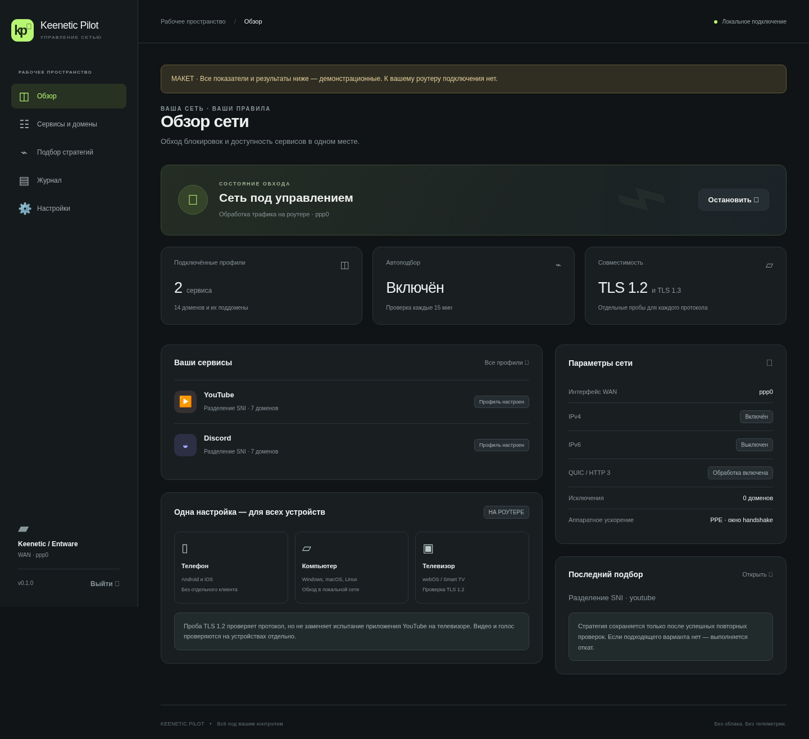

# Keenetic Pilot

Самостоятельный проект обхода DPI для Keenetic с Entware: собственные
веб-интерфейс, конфигурация и контроллер подбора стратегий. Первый целевой
стенд — **KN-1811, Entware на USB, Ростелеком, YouTube / Discord / webOS**.

**Текущая стадия: макет интерфейса и ранний прототип контроллера. Это ещё не
готовый выпуск для установки на роутер. Работа в сети Ростелеком и на webOS
не проверена.**

## Макет



- [Подбор стратегий](design/screenshots/strategy-picker.png)
- [Сервисы и домены](design/screenshots/profiles.png)
- [Мобильный интерфейс](design/screenshots/mobile.png)

```sh
python3 design/serve.py
```

Откройте локальный порт `9091`. Все показатели демонстрационные, что явно
указано в панели. Демонстрационный сервер не подключается к роутеру, не
запускает обход и запрещает изменение настроек.

## Чем проект отличается от источников идей

Веб-панель и Go-контроллер написаны здесь, а не скопированы из z2k или D2K.
Панель работает без CDN, внешних шрифтов и телеметрии.

Пакетный движок — отдельная зависимость **nfqws2** из
[necronicle/zapret2-z2k](https://github.com/necronicle/zapret2-z2k), а не новый
собственный сетевой движок. Его готовые методы вызываются явными параметрами.
Движок не включён в этот коммит и автоматически не скачивается.

Контроллер рассчитан на подбор отдельной стратегии для каждого сервиса:

1. Проверить прямое соединение.
2. Испытать варианты с принудительными TLS 1.2 и TLS 1.3, проверкой
   сертификата, HTTP-кода и контрольного фрагмента ответа.
3. Повторить выбранную стратегию после перезапуска движка.
4. Сохранить успешный вариант или восстановить предыдущую конфигурацию.

Из [z2k](https://github.com/necronicle/z2k) взяты идеи интеграции с Keenetic,
в частности сохранения видимости начальных пакетов через PPE. Из
[d2p](https://github.com/punisher89/d2p) — идея разделения наблюдения,
измерения и применения решения. Подробности: [THIRD_PARTY.md](THIRD_PARTY.md).

## Разработка прототипа

Нужен Go 1.24 или новее. Сторонних Go-модулей нет.

```sh
go test ./...
go build -o build/pilot ./cmd/pilot
./build/pilot --init --config local/config.json
./build/pilot --mode development --config local/config.json
```

Панель слушает `127.0.0.1:9080`. Ключ для входа лежит в
`local/access-token`. Файлы `local/` исключены из Git. Режим разработки
не изменяет firewall и не изображает запущенный обход.

## Что ещё предстоит

- Завершить и проверить установку / удаление, запуск Entware и восстановление
  правил после событий Keenetic NDM.
- Проверить настоящий nfqws2, NFQUEUE, IPv6, PPE и откат на KN-1811.
- Проверить воспроизведение Googlevideo, включая приложение YouTube на webOS.
- Добавить самостоятельные измерения QUIC и голоса Discord. Пока варианты
  UDP статические и экспериментальные; HTTPS-проверки их не подтверждают.
- Проверить реальные ClientHello разных устройств. Проба TLS 1.2 сама по
  себе не воспроизводит сетевой отпечаток телевизора.

Обход DPI не гарантирует доступ к ресурсу, заблокированному по IP, и не
заменяет туннель для таких случаев. Список стратегий не является обещанием
работоспособности у любого провайдера.
