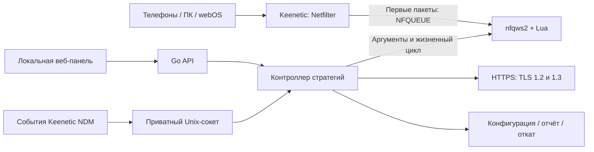

# Архитектура Keenetic Pilot

Pilot — отдельное приложение с собственным циклом сборки, установки,
конфигурацией и API. Пакетный движок подключён как внешняя зависимость.

## Собственная часть

- `internal/pilot/web`: интерфейс без внешних ресурсов, встроенный в бинарник.
- `lua/pilot-auto.lua` / `adaptive.go`: ротация для домена/TLS/IP, ограниченное
  сохранение, история, группы наблюдений и проверка кандидатов из опыта; используется внешняя библиотека `zapret-auto.lua`.
- `domain_controls.go` / `adaptive_reset.go`: ручные правила доменов, защита
  общего подбора от ручных переопределений, сброс опыта с остановкой писателя
  и восстановлением при ошибке.
- `config.go`: схема и проверка настроек, атомарная запись на USB.
- `manager.go`: ручное управление, последовательный подбор и повторный контроль.
- `probe.go`: независимые соединения с жёстким выбором TLS-версии и семейства IP,
  проверкой сертификата и ответа. Адреса закрепляются после DNS-разрешения;
  доступ к приватным адресам через проверки запрещён.
- `backend.go` / `firewall.go`: управление nfqws2 и собственными правилами,
  журнал аварийного восстановления, возврат исходных sysctl.
- `control.go`: блокировка единственного экземпляра, диагностика и приватный IPC.
- `scripts` / `packaging`: собственные сборка, установка, служба и NDM-хук.

Контроллер получает root для NFQUEUE и правил. Первое подключение защищено
одноразовым кодом на 15 минут из SSH; затем пользователь задаёт пароль.
Пароль хранится как PBKDF2-SHA256 с солью, сеанс — в HttpOnly SameSite-cookie.
Есть ограничение попыток входа и проверка Origin. Bearer-ключ API сохраняется
для совместимости, но вводить его в браузере больше не требуется.
В конфигурации нет исполняемых shell-строк. Ключ не передаётся NDM-хуку;
служебный сокет имеет права `0600`.

Sysctl `nf_conntrack_acct` и `nf_conntrack_tcp_be_liberal` меняются только
при наличии соответствующих параметров в прошивке; исходные значения
записываются в журнал восстановления. Отсутствие параметра не считается
отсутствием conntrack: некоторые прошивки имеют счётчики без этого переключателя.
Ограниченные правила `connbytes` остаются обязательными; при ошибках их установки
запуск откатывается. Весь поток без ограничения в NFQUEUE не направляется.

Установочный вход `install.sh` получает готовую сборку из ветки `packages`
этого репозитория. SHA-256 манифеста закреплён в самом установщике; по нему
проверяется архив нужной архитектуры. LAN/WAN определяются по интерфейсам и
локальному маршруту. Первый запуск в браузере позволяет выбрать подключение,
запустить обход и начать подбор без редактирования JSON.

## Внешний движок

nfqws2 выполняет разбор и изменение пакетов. Используются его стандартные
Lua-библиотеки и фиксированные векторы аргументов. Версия, исходная ревизия,
URL и SHA-256 архива закреплены в `dependencies/nfqws2.env`. Код движка не
выдаётся за собственную разработку и не перелицензируется лицензией Pilot.

Активный выбор стратегии опирается на повторные HTTPS-пробы. Выбирается
первый вариант, прошедший все заданные проверки, затем он подтверждается после
перезапуска. Это не поиск глобально самого быстрого варианта. Дополнительно включается
пассивный автоподбор по трафику: независимые методы для домена, TLS и IP-семейства.
Алгоритм ротации — API `circular` внешнего движка; собственная часть связывает
его с сохранением, группировкой и панелью. Подробности: [STRATEGIES.md](STRATEGIES.md).

## Проверенная область и следующие этапы

Локальные тесты проверяют настоящий парсер nfqws2, TLS 1.2/1.3, конфигурацию,
API, подбор/откат, правила через модель команд и реальную службу без перехвата
пакетов. Кросс-компиляция проверяет сборку архитектур, не их работу в устройстве.

Владелец KN-1811 подтвердил обход YouTube и Discord на версии `0.1.0-alpha.7`.
Новая пассивная ротация проверена локальными Lua-тестами и парсером движка;
её работу на живом трафике роутера ещё нужно подтвердить. Также требуется
проверка NDM-событий и перезагрузки устройства.
Следующие отдельные задачи — измерение QUIC, Discord Voice и сценариев видео
Googlevideo, а также проверка реальных ClientHello webOS. IP-блокировки могут
требовать отдельного туннеля; существующие стратегии этого не обещают.
